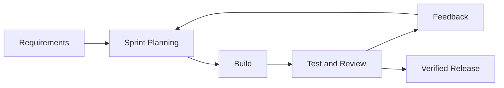
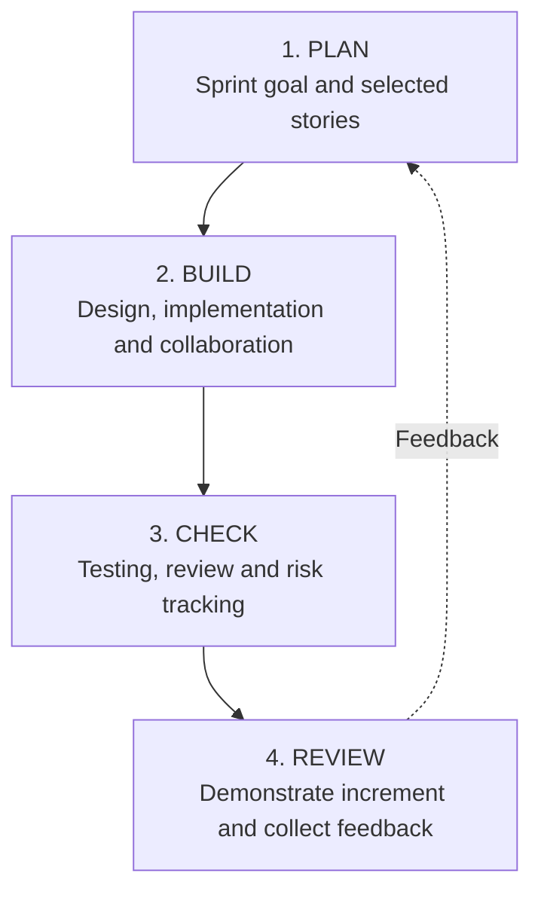
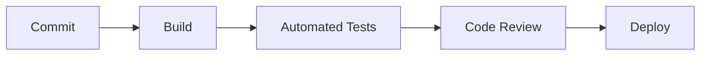

# Online Examination & Proctoring System (OEPS)

<p align="center">
  <strong>Agile Software Development | Case Study & Sprint Planning</strong>
  <br />
  MIT Art, Design and Technology University, Pune
  
</p>

---

## Table of Contents

- [About the Project](#-about-the-project)
- [Problem Statement](#-problem-statement)
- [Project Objectives](#-project-objectives)
- [Proposed Development Methodology](#-proposed-development-methodology)
- [Case Study Analysis](#-case-study-analysis)
- [OEPS Product Backlog](#-oeps-product-backlog)
- [Agile Estimation and Sprint Planning](#-agile-estimation-and-sprint-planning)
- [Sprint Execution Workflow](#-sprint-execution-workflow)
- [Quality Assurance and Risk Management](#-quality-assurance-and-risk-management)
- [Tools and CI/CD Workflow](#-tools-and-cicd-workflow)
- [Repository Structure](#-repository-structure)
- [Project Deliverables](#-project-deliverables)
- [Team Members](#-team-members)
- [Scope and Limitations](#-scope-and-limitations)
- [References](#-references)

---

## About the Project

The **Online Examination and Proctoring System (OEPS)** is an academic case study developed as part of the Agile Software Development coursework. It explores how software engineering methodologies can be applied to create a secure, reliable, and adaptable online examination platform.

The study examines real-world failures in commercial examination software and uses their lessons to recommend an appropriate development methodology for OEPS.

The project also applies concepts from Agile estimation, product backlog management, sprint planning, sprint execution, quality assurance, risk management, and Continuous Integration and Continuous Delivery (CI/CD).

> **Core recommendation:** Combine Agile/Scrum practices for evolving features with V-Model verification practices for security-critical and high-risk examination functions.

## Problem Statement

Online examination platforms must support multiple critical functions while maintaining reliability during high-stakes examinations.

| Challenge | Potential consequence |
|---|---|
| Authentication and access-control failures | Unauthorized access to examinations |
| Answer-saving or submission failures | Loss of student responses |
| Last-minute software updates | Examination disruption |
| Unvalidated proctoring systems | Incorrect or unreliable flags |
| Changing stakeholder requirements | Delays and inflexible functionality |

**Research question:** Which development approach—Agile/Scrum, the V-Model, or a combination of both—is most suitable for building OEPS while balancing security, reliability, and changing stakeholder needs?

## Project Objectives

- Analyze documented failures in commercial examination software.
- Compare Agile/Scrum and the V-Model for high-stakes software development.
- Recommend a hybrid development methodology for OEPS.
- Identify and prioritize product backlog items using user stories.
- Apply INVEST principles to create small, testable requirements.
- Estimate work using Planning Poker and story points.
- Plan and execute sprints using an iterative workflow.
- Define testing, risk mitigation, code review, and release practices.
- Explain how version control and CI/CD can support reliable delivery.

## Proposed Development Methodology

The project recommends a **hybrid Agile + V-Model approach** rather than relying entirely on either methodology.

| Development approach | Strength | Limitation in OEPS | Proposed use |
|---|---|---|---|
| Agile/Scrum | Iterative delivery and stakeholder feedback | Critical workflows still require rigorous verification | Features with evolving requirements |
| V-Model | Structured verification and validation | Changes can be more difficult to accommodate | Security-critical and high-risk modules |
| Hybrid approach | Balances adaptability and verification | Requires coordination between iterative work and formal testing | Overall OEPS development strategy |

### Module-wise approach

| OEPS module | Recommended approach | Justification |
|---|---|---|
| Authentication and user management | V-Model practices | Security and access control |
| Exam timer, auto-save and submission | V-Model practices | Preventing answer loss and submission failures |
| AI/camera-based proctoring | Agile iterations with formal validation | Evolving functionality with high-stakes consequences |
| Exam scheduling and question management | Agile/Scrum | Changing faculty requirements |
| Dashboards, results and reports | Agile/Scrum | Iterative improvements based on feedback |

### Proposed development lifecycle



*This diagram represents the proposed workflow, not an implemented or deployed application.*

## Case Study Analysis

The written case study analyzes three reported examination software incidents and academic research on hybrid development processes.

| Case | Reported issue | Lesson for OEPS |
|---|---|---|
| ExamSoft — 2014 | Answer-upload failures following a bar examination | Perform load, stress and acceptance testing on submission workflows |
| ExamSoft Examplify — 2018 | Examination disruptions associated with software updates shortly before the exam | Enforce release freezes and regression testing |
| California Remote Bar Exam — 2020–2021 | Technical problems and large numbers of proctoring flags | Validate proctoring across devices and use human review |
| Hybrid Agile/V-Model research | Research into combining iterative development with structured verification | Balance flexibility with systematic testing |

These cases are analyzed using secondary sources. The process-related causes and recommendations for OEPS represent the case study authors' analysis of the reported incidents.

## OEPS Product Backlog

The presentation defines example user stories prioritized according to their illustrative value and risk.

| ID | User story | Purpose | Priority |
|---|---|---|---|
| US-01 | As a student, I want to log in securely. | Protect examination access | High |
| US-02 | As a student, I want my answers to be auto-saved. | Prevent answer loss | High |
| US-03 | As a student, I want a visible examination timer. | Track remaining time | High |
| US-04 | As a proctor, I want to review flagged sessions. | Support fair examination review | Medium |
| US-05 | As a student, I want to view my results. | Access released outcomes | Medium |

*Priorities are illustrative and should be confirmed with the product owner.*

### INVEST principles

User stories are evaluated using the INVEST framework before estimation.

| Principle | Meaning |
|---|---|
| **I — Independent** | Minimize dependencies on other stories |
| **N — Negotiable** | Allow implementation details to be discussed |
| **V — Valuable** | Deliver meaningful user or business value |
| **E — Estimable** | Make effort reasonably assessable |
| **S — Small** | Keep work manageable within a sprint |
| **T — Testable** | Define verifiable acceptance criteria |

For example, the broad requirement *"Build the full online exam system"* can be divided into smaller stories such as secure login, auto-save answers, and the examination timer.

## Agile Estimation and Sprint Planning

### Estimation techniques

| Technique | Purpose |
|---|---|
| Planning Poker | Allows team members to estimate independently and discuss differences |
| Story points | Represent relative effort, complexity and uncertainty |
| Velocity | Uses completed work from previous sprints to guide future capacity planning |

### Illustrative sprint backlog

| Backlog item | Story points |
|---|---:|
| Secure login | 3 |
| Auto-save answers | 5 |
| Examination timer | 3 |
| **Total planned effort** | **11 points** |

The 11-point total is an example from the presentation. It is not a measured team velocity or a record of completed development work.

## Sprint Execution Workflow

The project follows a four-stage conceptual workflow for sprint execution.



### Example: Auto-save feature

| Stage | Activity |
|---|---|
| Sprint goal | Save examination answers reliably |
| Acceptance criteria | Save after answer changes, show save status and recover answers after refresh |
| Implementation | Develop the save API and review the code |
| Verification | Test saving, refresh recovery, connection loss and authorization |
| Definition of Done | All required checks pass, code is merged and the increment is demonstrated |

The implementation details and workflow are illustrative and would need to be confirmed by an actual development team.

## Quality Assurance and Risk Management

Quality assurance should be part of every sprint rather than postponed until the end.

### Testing strategy

| Test level | Purpose |
|---|---|
| Unit testing | Verify individual functions |
| Integration testing | Verify interactions between connected modules |
| System testing | Check the end-to-end examination workflow |
| Acceptance testing | Confirm that requirements and acceptance criteria are satisfied |
| Load and stress testing | Assess system behavior under examination traffic |

### Risk register

| Risk | Impact | Proposed mitigation |
|---|---|---|
| Auto-save failure | Student answers may be lost | Test recovery and saving under failure conditions |
| Unauthorized login or access | Compromised examination integrity | Validate authentication and access controls |
| Last-minute release defects | Examination disruption | Freeze releases and run regression tests |
| Incorrect proctoring flags | Unfair treatment of students | Validate detection and require human review |
| High simultaneous traffic | Slow responses or failed submissions | Run realistic load and stress tests |

Each risk should be tracked with an owner, likelihood, impact, and mitigation action.

## Tools and CI/CD Workflow

The presentation identifies tools and practices that can support collaborative development and repeatable delivery.

| Tool or practice | Intended purpose |
|---|---|
| GitHub | Version control, pull requests and code review |
| Jira / Trello | Product backlog, sprint board and task tracking |
| Automated testing | Detect defects during development |
| CI/CD | Automate repeatable build, test and release steps |
| Daily Scrum | Communicate progress and identify blockers |
| Sprint review | Demonstrate work and gather stakeholder feedback |

### Proposed CI/CD pipeline



The pipeline illustrates a proposed workflow. A working pipeline is not included in the current project deliverables.

## Repository Structure

```text
OEPS/
├── README.md
├── OEPS_Case_Study.docx
└── OEPS_Review_2_Professional_Short.pptx
```

| File | Description |
|---|---|
| `README.md` | Project overview, methodology, findings and Agile workflow |
| `OEPS_Case_Study.docx` | Written report covering the problem statement, methodology, case analysis, comparative findings and recommendations |
| `OEPS_Review_2_Professional_Short.pptx` | Second jury review presentation covering Agile estimation, sprint planning, execution, quality assurance, risks and CI/CD |

## Project Deliverables

| Deliverable | Format | Coverage |
|---|---|---|
| OEPS case study | DOCX | Real-world failures and development methodology selection |
| Second jury review | PPTX | Agile planning, estimation and sprint execution |
| Project documentation | Markdown | Repository documentation and navigation |

## Team Members

**Group G4 — TY-AIA-2 / TY-AIA-4**

| No. | Name |
|---:|---|
| 1 | Akhil Patel |
| 2 | Aashu Aman |
| 3 | Parth Sharma |
| 4 | Atharva Kumar |
| 5 | Pawan Angad Jadhav |

**Institution:** MIT School of Computing, MIT Art, Design and Technology University, Pune  
**Course:** Agile Software Development  
**Academic year:** 2026–27

## Scope and Limitations

This repository documents an academic case study and development-planning exercise. The included deliverables are a written report and a presentation.

**The current deliverables do not include:**

- A functioning online examination application.
- An implemented authentication or database system.
- A working auto-save or examination submission service.
- An implemented AI-based proctoring system.
- Automated test suites or a configured CI/CD pipeline.

The user stories, sprint estimates, risks and workflows describe the proposed development process. They should not be interpreted as proof that these application features have been implemented or deployed.

## References

The case study uses publicly reported examination software incidents and research on hybrid Agile and V-Model processes.

For the complete bibliographic details and source URLs, consult the **References** section of [`OEPS_Case_Study.docx`](./OEPS_Case_Study.docx).

## Conclusion

The OEPS case study highlights the importance of selecting a development methodology that addresses both changing requirements and the consequences of software failure.

The recommended hybrid approach uses Agile/Scrum to deliver evolving functionality incrementally and V-Model practices to strengthen verification of critical workflows such as authentication, answer saving, submission and proctoring.

The accompanying presentation applies Agile concepts to product backlog management, estimation, sprint execution, quality assurance, risk management and CI/CD planning.

---

<p align="center">
  <strong>Agile Software Development | OEPS | Group G4</strong>
  <br />
  MIT Art, Design and Technology University, Pune
</p>
